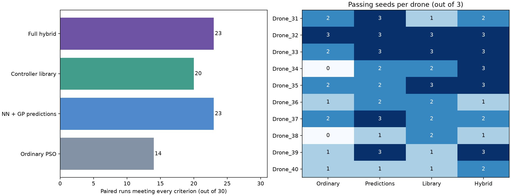

# Prediction-initialized PSO for quadrotor attitude tuning

Research code and recorded simulation results supporting **Prediction-Initialized Particle Swarm Optimization for Quadrotor Attitude Tuning under a Limited Evaluation Budget**.

## Results and scope

The frozen independent test contains ten previously unseen simulated plants, three paired search seeds per plant, four initialization policies at 1800 unique fitness evaluations, and an ordinary PSO reference at 3264 evaluations. One fitness evaluation simulates six single-axis commands for a complete eight-gain controller.

| Initialization | Quality passes / 30 |
|---|---:|
| Ordinary PSO | 14 |
| NN ensemble + GP predictions | 23 |
| Stored controller library | 20 |
| Hybrid predictions + library | 23 |

The hybrid saved 44.9% of objective evaluations and 42.9% of median paired online tuning time relative to the longer reference. Offline preparation is excluded from those savings. The independent unit is the plant, not each repeated seed. The whole-plant label-swap sensitivity analysis gives p = 0.03125 for the prespecified hybrid-ordinary contrast.

**All methods failed all 360 combined-axis controller-scenario checks per method.** The reported quality pass rate is a relative single-axis tuning benchmark, not a flight-success probability. This repository does not provide hardware-validated flight gains or establish general flight robustness. The prediction arm uses both an NN and a GP, not an NN alone.



## Repository contents

The complete directory tree is stored in numbered `study_artifacts_*.zip` archives to support browser uploads. Run `python unpack_study.py` after downloading or cloning this repository. The extraction script verifies the archive hashes and restores the paths listed below. No optimization is run during extraction.

The core simulation and analysis scripts are also provided as browsable copies at the repository root; use the restored directory tree for execution.

- `study/model.py`, `study/study.py`, `study/pipeline.py`: frozen plant, objective, constraints and ordinary PSO implementation.
- `study/config.json` and `study/manifest.json`: physical factors, gain bounds, timing, and training/development assignments.
- `study/drones/Drone_01` through `Drone_20`: 600 archived training-run summaries used to construct labels.
- `study/neural network by python/train.py`: fitting and cross-validation code.
- `study/neural network by python/models/`: the two selected serialized predictors.
- `study/neural network by python/final_unseen_1800/`: frozen final-test protocol, plant specifications, per-run metrics, final gains and all 150 evaluation ledgers.
- `paper/analyze_revision.py`: portable analysis entry point for statistics, cost accounting, convergence and the development replay.
- `paper/analysis/`: numerical exports and audit records.

Historical training ledgers and every discarded development experiment are not included. Their aggregate costs are recorded in `offline_costs.json`. The complete final-test ledgers and the label-generating training summaries are included.

## Reproduce the paper analyses

Use Python 3.11 or 3.12 and a virtual environment. From the repository root:

```sh
python unpack_study.py
python -m pip install -r requirements.txt
python verify_artifacts.py
python paper/analyze_revision.py
```

The analysis reads `study/` by default. Set `QUADROTOR_STUDY_ROOT` to override its location. It does not rerun optimization or modify the frozen results. The script enumerates all 1024 whole-plant label swaps, calculates the reported bootstrap intervals, reconstructs convergence, and replays two development controllers. It writes derived files under `paper/`.

`scikit-learn==1.5.2` is required to inspect the serialized predictors in their original library version. Joblib files are executable serialization and should be loaded only from a trusted copy of this repository. The archived launch scripts retain their original machine-specific paths and hashes for provenance. Use the portable analysis entry point above; running historical optimization launchers on a different machine requires a separately documented adaptation.

## Reproducibility and interpretation

`study/SHA256_MANIFEST.json` records file hashes for the frozen study copy. `verify_artifacts.py` checks those hashes and the final-run counts without launching optimization. The test was frozen before generating Drone_31-40. Budget selection used different development plants. No final-test retraining is performed by the analysis script.

The recorded training cost was 1,958,400 objective evaluations. Break-even figures in the paper are conditional illustrations and omit some offline work and failed-run fallback. The development replay supports a body-rate/Euler-angle mapping limitation for one coupled maneuver. It does not explain every stress-case failure or correct the controller.

## Publication and reuse

This is supporting material for a manuscript being prepared for journal submission. No acceptance or publication is claimed.

Code is released under the MIT License and data under CC BY 4.0. See [LICENSE](LICENSE), [LICENSE-DATA.txt](LICENSE-DATA.txt), and [LICENSING.md](LICENSING.md) for license texts, scope, and data attribution.
